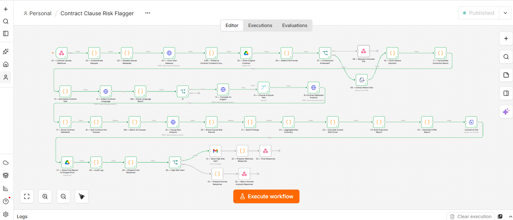
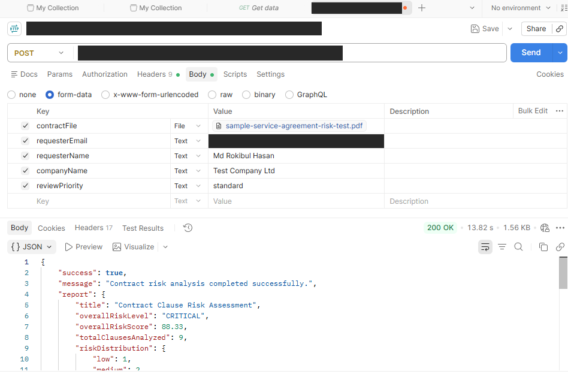
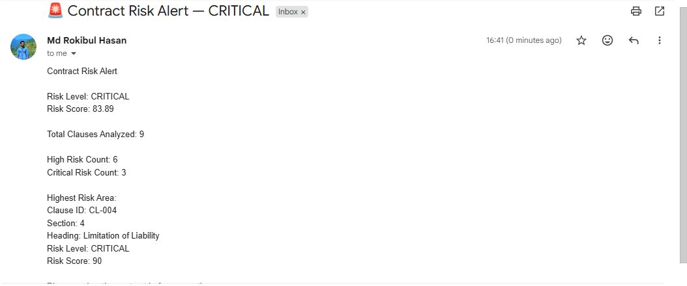

# Contract Clause Risk Flagger

An n8n workflow that accepts a contract through a webhook, analyzes it clause by clause with an LLM, calculates a risk score, stores an HTML report in Google Drive, and sends an email alert for CRITICAL results.



## Tech Stack

| Tool | Purpose |
|---|---|
| n8n | Workflow orchestration |
| Groq API (`openai/gpt-oss-20b`) | Language detection, translation, metadata extraction, clause risk analysis |
| VirusTotal API | File scan (node 04) |
| Google Drive | Stores the original contract and the final HTML report |
| Gmail | Sends the risk alert email |
| JavaScript (Code nodes) | Validation, parsing, scoring, report building |

## How It Works

1. **Intake (01-03):** `POST` webhook with header authentication, then request and upload-metadata validation.
2. **Scan and store (04-05):** File sent to VirusTotal, original contract saved to Google Drive.
3. **Format check (06-08):** File format detected. Password-protected PDFs are rejected with HTTP 422.
4. **Text extraction (09-12):** Native text extraction, an extraction-quality check (node 10), consolidation, and text normalization.
5. **Language (13-15):** Language detected; non-English text is translated to English before analysis.
6. **Metadata (16-17):** LLM extracts contract metadata, then it is parsed.
7. **Clauses (18-20):** Contract split into clauses, all clauses sent in one batch to the LLM, response parsed.
8. **Risk (21-23):** Findings built, summary aggregated, overall score calculated.
9. **Report (24-27):** Executive report, HTML report, converted to a file and stored in Google Drive.
10. **Audit and response (28-35):** Audit log, final response. If the overall level is CRITICAL, an alert email is sent.

## Risk Scoring

Each clause gets a score from 0 to 100 from the LLM. The overall score is calculated in code (node 23):

```
overall = average clause score
        + min(15, criticalCount * 5)
        + min(10, highCount * 2)
```

The result is capped between 0 and 100.

| Level | Score |
|---|---|
| LOW | 0-24 |
| MEDIUM | 25-49 |
| HIGH | 50-74 |
| CRITICAL | 75-100 |

## API Usage

```
POST /webhook/contract-clause-risk-flagger
Content-Type: multipart/form-data
```

| Field | Type |
|---|---|
| `contractFile` | File (PDF, DOCX, or TXT) |
| `requesterEmail` | Text |
| `requesterName` | Text |
| `companyName` | Text |
| `reviewPriority` | Text (e.g. `standard`) |

The webhook requires a header-auth credential configured in n8n.

### Example Test Result

The sample response below comes from one Postman test run with a sample service agreement:

```json
{
  "success": true,
  "message": "Contract risk analysis completed successfully.",
  "report": {
    "title": "Contract Clause Risk Assessment",
    "overallRiskLevel": "CRITICAL",
    "overallRiskScore": 88.33,
    "totalClausesAnalyzed": 9
  }
}
```



### Alert Email



## Setup

1. In n8n, choose **Import from File** and select `contract-clause-risk-flagger.json`.
2. Create your own credentials (none are included in the file):
   - HTTP Header Auth for the webhook
   - HTTP Header Auth for VirusTotal
   - HTTP Header Auth for Groq
   - Google Drive OAuth2
   - Gmail OAuth2
3. In nodes 05 and 27, select your own Google Drive folder.
4. In node 31, set the alert recipient email address.
5. Activate the workflow and send a test request.

## Known Limitations

- Node 10 only decides whether OCR is needed. No OCR service is connected, so scanned PDFs without a text layer are not fully handled. **TO BE CONFIRMED:** behavior for scanned documents.
- The alert email is sent only when the overall level is CRITICAL, not for HIGH.
- Output comes from an LLM and is not legal advice.

## Possible Improvements

- Connect an OCR service for scanned documents
- Add HIGH-level alerts
- Compare clauses against company-specific policies
- Add a human review step

## Status

Working end to end in testing on n8n.
